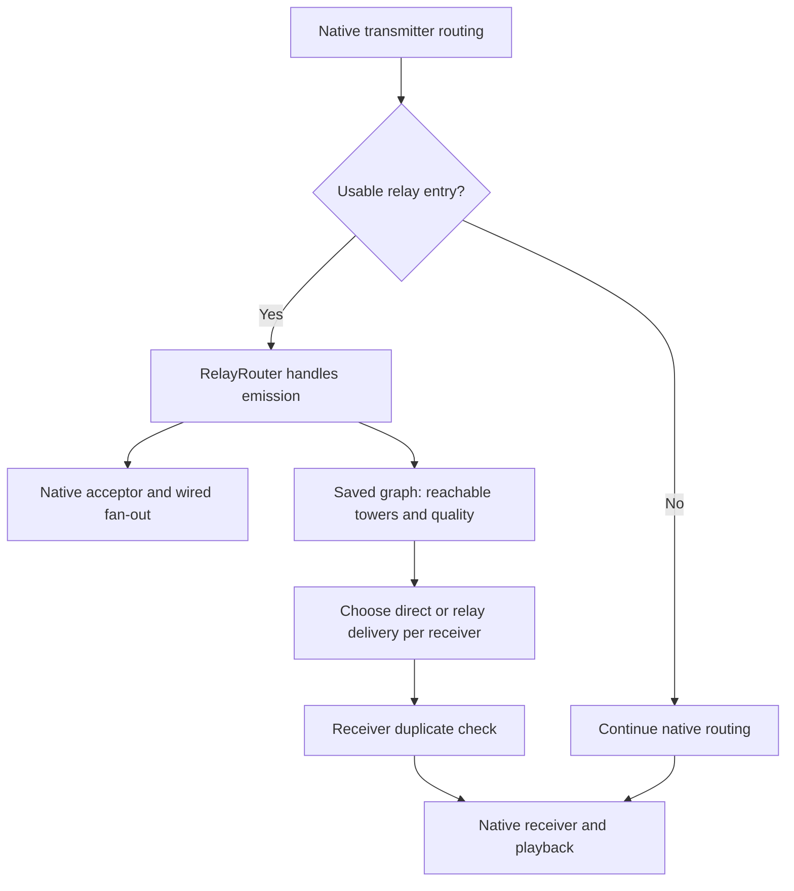

# Simple Radio Repeaters 0.1.3

Gameplay and implementation guide

Fabric Minecraft 1.20.1 · Simple Radio 1.20.1-4.5.7.9

This guide describes the released 0.1.3 code. It is intended for players building radio installations, server operators, and developers maintaining the addon. The proposed six-card model and in-world insertion controls are not implemented in this version.

## Contents

1. [In-game operation](#1-in-game-operation)
2. [How the network works](#2-how-the-network-works)
3. [Antenna verification and persistence](#3-antenna-verification-and-persistence)
4. [Code reference](#4-code-reference)
5. [Build, tests, and maintenance](#5-build-tests-and-maintenance)

## 1. In-game operation

### 1.1 What the addon adds

Simple Radio Repeaters adds two items: the **Repeater Bank**, a block that connects an antenna to a relay network, and the **Frequency Card**, which selects a frequency and modulation for that bank.

A bank has nine card slots and one catalyst slot. It can relay up to nine distinct frequency/modulation pairs through one antenna. It uses Simple Radio's transmission, reception, attenuation, and interference settings. It does not introduce a separate voice server or a second radio protocol.

The bank extends wireless coverage between normal Simple Radio devices. A speaker, receiver, microphone, transmitter, or handheld at either end still performs its normal role. A bank does not capture nearby speech by itself; the sender must use a handheld or a microphone connected to a transmitter.

Once verified, a stationary tower can continue relaying from its saved record when its chunk unloads. No tower chunk is kept loaded by the relay system.

### 1.2 Installation and compatibility

Install `simple-radio-repeaters-fabric-1.20.1-0.1.3.jar` on the server and every client. When updating, remove the previous addon jar so that only one version is installed. Existing bank inventories, identifiers, and saved network records are retained.

| Component | Requirement |
| --- | --- |
| Minecraft | Java Edition 1.20.1 |
| Loader | Fabric Loader 0.19.0 or later |
| Java runtime | Java 17 or later |
| Simple Radio | Exactly 1.20.1-4.5.7.9 |
| Simple Voice Chat | 1.20.1-2.6.0 or later |
| Other dependencies | Fabric API and Simple Radio's Lexiconfig dependency |

The development build uses Fabric Loader 0.19.3, Fabric API 0.92.5+1.20.1, Simple Voice Chat 2.6.18, and Lexiconfig 1.4.21-epic. The exact Simple Radio release matters because the addon hooks its internal routing classes and antenna API.

### 1.3 Crafting

A Frequency Card uses two paper, two copper ingots, and one redstone. A Repeater Bank uses four iron ingots, two copper ingots, one redstone, one Simple Radio receiver item, and one Simple Radio transmitter item.

| Recipe | Top row | Middle row | Bottom row |
| --- | --- | --- | --- |
| Frequency Card | Empty / Paper / Empty | Copper / Redstone / Copper | Empty / Paper / Empty |
| Repeater Bank | Iron / Copper / Iron | Receiver / Redstone / Transmitter | Iron / Copper / Iron |

Each recipe produces one item. Cards are unstackable. Each bank slot holds one item.

### 1.4 Build the first tower

1. Build an antenna using Simple Radio's usual antenna structure and a solid core block. A native copper-wire extension can connect the core to the antenna.
2. Place the Repeater Bank against a horizontal side of the core. Clicking that side makes the bank face outward; its antenna scan starts from the block directly behind it.
3. Put a Frequency Card in the native radiosmithing station and apply the desired frequency and AM/FM modulation. The allowed number format follows the main mod's configuration.
4. Right-click the bank to open its menu, then insert the card into a channel slot.
5. Put one gilded blackstone in the catalyst slot and leave the bank Enabled.
6. Allow verification to finish. A functioning installation shows a positive antenna score and **Ready to relay**. Its front indicator uses the active texture.

A blank card does not enable a channel. Two matching cards count as one channel. The addon's channel key includes both the frequency string and modulation, so matching numbers on AM and FM are separate bank selections.

The catalyst is a presence requirement in this release. The virtual relay calculation does not apply the main mod's catalyst-efficiency percentage, and gilded blackstone is not consumed while relaying. The bank accepts gilded blackstone specifically, rather than every catalyst registered by Simple Radio.

### 1.5 Extend the network

Place matching cards in each bank that should relay a channel. A route can use several towers; the original transmitter does not need to reach the final receiver directly. Links can form chains, branches, or rings, and each direction is evaluated independently.

A bank with several cards participates in several independent networks. Each uses the same full antenna score; adding cards does not divide a shared transmission-power budget between channels. The bank does **not** convert between those channels. To convert a received channel to another channel, use a normal receiver wired to a normal transmitter tuned to the second channel. Banks supporting both channels can relay the two legs, but the conversion happens in the native devices.

An ordinary receiver-to-transmitter wire bridge retains Simple Radio's existing source-power behavior. It is not another virtual repeater departure: the native transmitter does not necessarily reset the received source to its own full antenna power. The receive-side margin and subsequent link therefore still matter.

### 1.6 Power, range, and audio quality

The relay system treats transmission power and audio degradation separately. Each virtual repeater departure uses that tower's full transmission power, while the packet keeps the worst interference encountered along the selected route.

| Leg | Power used | Effect on audio quality |
| --- | --- | --- |
| Sender to entry tower | Sender's current power and the tower's reception bonus | Establishes the entry quality, including any degradation already on the source |
| Tower to tower | Sending tower's full output and receiving tower's reception bonus | A worse link raises the carried interference; a better link leaves it unchanged |
| Exit tower to receiver | Exit tower's full output and the actual receiver's reception strength | Final quality is the worse of the carried interference and this last wireless leg |

Good relay hops do not repeatedly add the same noise, and amplification does not restore already-degraded audio. A sufficiently weak leg can also make the route unreachable rather than merely noisy.

The final broadcast can reach a handheld that cannot transmit back to the same tower. Hearing a powerful tower does not establish a return link from the handheld's weaker transmitter. A reply needs to reach an entry tower independently.

For example, consider User 1 at -1,000 blocks, tower A at 0 with antenna score 16, towers B and C at 4,000 and 8,000 with scores above 100, and User 2 at 11,000. Under the tested server settings, User 1 can reach A cleanly and C can deliver a clear final broadcast over 3,000 blocks. User 2's weaker handheld uplink over those same 3,000 blocks can enter the network with degraded audio, which stays degraded on the return route. The layout illustrates direction-dependent quality; antenna scores are not universal block-range values.

The route solver may leave the network at any reachable tower that can deliver to a receiver. It does not force a packet to visit every named tower in a chain if a shorter route has the same or better quality.

### 1.7 Read the bank menu

The menu displays antenna score, distinct channel count, and **Tower links**. A tower link is a distinct neighbouring bank reachable by an outgoing direct tower-to-tower link on at least one selected channel. This count excludes remote towers reached only through intermediate banks, and it does not prove that the reverse link works.

| Status | Meaning |
| --- | --- |
| Ready to relay | Current verification is complete and the bank is eligible |
| No connected antenna | A completed, confirmed scan has no usable antenna score |
| Add gilded blackstone | The catalyst is required and absent |
| Insert a tuned card | No active channel selection exists |
| Repeater disabled | Enabled is switched off |
| Waiting for antenna connection | Verification is pending and there is no eligible saved snapshot |
| Relaying; checking antenna | Verification is pending, but an eligible saved snapshot continues to relay |

The checks have a priority: Disabled, missing required catalyst, no channel, pending verification, then antenna score. A bank with more than one problem shows the first applicable message.

### 1.8 What triggers verification in 0.1.2

The immediate saved-record updates below apply when a record already exists. A new bank's first record is created after an accepted antenna scan.

| Action or event | Requests antenna verification? | Immediate effect |
| --- | --- | --- |
| Add or remove a card, or change its frequency/modulation | Yes | Publishes the current channel set |
| Insert gilded blackstone into an empty catalyst slot | Yes | Publishes catalyst presence |
| Switch Disabled to Enabled | Yes | Publishes Enabled and reuses a valid cached antenna while checking |
| Remove the catalyst | No new scan request | Stops eligibility immediately when a catalyst is required |
| Switch Enabled to Disabled | No new scan request | Stops eligibility immediately |
| Click an empty slot, attempt an invalid insertion, or write identical settings | No | No relay configuration change |
| Load a bank instance, receive an antenna/neighbor dirty notification, or run the refresh command | Yes | Starts verification without discarding the saved antenna merely because it is pending |

Disabling or removing a catalyst does not cancel a verification that was already pending. The distinction above describes whether that action starts a new check. Loaded banks still respond to local neighbour notifications; the removed global block-change watcher no longer invalidates unloaded tower records.

### 1.9 Commands and configuration

| Command | Permission | Purpose |
| --- | --- | --- |
| `/radiorepeaters status` | No explicit operator requirement | Shows configured/ready records, loaded/saved counts, and packet counters |
| `/radiorepeaters list` | Operator level 2 | Lists positions, loaded/saved/inactive state, antenna score, and channels |
| `/radiorepeaters refresh` | Operator level 2 | Reconciles saved positions in loaded chunks and marks loaded banks for antenna verification; never loads remote chunks |

The counters describe routing activity. **Forwarded frames** counts managed transmitter emissions, not physical tower-to-tower hops. **Delivered receiver packets** counts first arrivals at the receiver hook before later native acceptance and playback processing. A moving counter alone does not prove that a speaker produced audible sound.

The addon creates `config/simpleradio-repeaters.json`:

```json
{
  "maxRelayHops": 64,
  "persistentUnloadedTowers": true,
  "requireCatalyst": true
}
```

`maxRelayHops` is clamped to 1-128. It counts tower visits, including the entry tower; a route through A, B, and C uses three. `persistentUnloadedTowers: false` excludes unloaded records from route construction. `requireCatalyst: false` permits operation without gilded blackstone. These addon settings are loaded at startup; restart after changing them. The retired `antennaRefreshTicks` option has no effect.

Ready counts report a record's eligibility. With persistence disabled, a saved record can still be labelled ready in the summary while being excluded from routing until its bank loads.

### 1.10 Troubleshooting

First verify matching frequency **and** modulation, Enabled, gilded blackstone, a positive antenna score, and the core behind the bank. If the antenna uses a wire extension, let pending verification finish before treating a temporary wait as a disconnection.

For one-way or noisy reception, test the handheld-to-entry-tower leg in the affected direction. A strong outgoing broadcast can hide a weak return uplink. If channels are bridged through a native receiver/transmitter pair, test that conversion and its departure link separately.

If routing counters move but no sound is heard, check the native receiver, its wire/speaker chain, handheld state, and Simple Voice Chat playback settings. The bank's counters stop before audible playback.

After changing a loaded antenna, `/radiorepeaters refresh` can request a new scan. It also removes stale bank records in already-loaded chunks. It cannot inspect an unloaded tower or bypass missing antenna dependencies. A saved record deliberately retains its last verified geometry until a complete verification can replace it.

## 2. How the network works

### 2.1 Responsibilities and data flow

Simple Radio owns microphone capture, encoded audio, native devices, wires, receiver processing, and playback. The addon selects wireless deliveries and adds relay metadata to the existing `RadioSource` objects.

The server maintains immutable tower records grouped by dimension and channel. It builds a directed graph from the eligible records. A transmission probes reachable entry towers, calculates usable routes and exits, and delivers one selected source copy to each qualifying live receiver.

Virtual hops are a calculation over saved records. They do not create native transmitter/receiver entities at every bank, decode audio at every tower, or schedule a travel delay per hop.



The diagram shows the logical branches. Wired fan-out remains a native operation and can lead to additional transmitters or other routers. Those sources share the same frame metadata when copied.

### 2.2 What makes a tower eligible

A `TowerRecord` is eligible when it is enabled, satisfies the configured catalyst requirement, has been verified, has an antenna score greater than zero, and selects at least one channel. Network construction also requires the record to match the dimension/channel being queried. When unloaded persistence is disabled, the bank must be in the manager's loaded-instance map.

The virtual RF position is the centre of the bank block, not the tip of the antenna. Antenna geometry contributes a score to transmission and reception strength. The graph uses dimension-scaled distances; in the Overworld the scale is one.

Records are sorted by UUID when constructing a graph, giving the node indices a stable order for a fixed record set. Every ordered pair of distinct towers is tested separately. A reachable A-to-B edge does not automatically create B-to-A.

### 2.3 Link calculation

`NativeRadioAdapter` obtains settings from Simple Radio's live frequencing types. Virtual towers transmit as the native `TRANSMITTER` type and receive as the native `RECEIVER` type. A final handheld or physical receiver uses its own reception power and floor.

For a tower with antenna score `A`:

```text
tower TX power = native TX base power for AM/FM + A * TX antenna aptitude
tower RX bonus = native RX base reception power + A * RX antenna aptitude
```

`RadioLinkMath.receive()` evaluates a leg from distance `d`, current power `P`, transmission cap `C`, receiver bonus `R`, reception floor `f`, loss coefficient `k`, degradation threshold `t`, and base interference `b`.

It first rejects a non-finite/negative distance, non-positive power, or a failed native reachability check:

```text
P + R < d * k
```

If reachability passes, the effective distance is:

```text
effective distance = d                      when d <= f
effective distance = max(f, d - R)           when d > f
```

Remaining power depends on the configured diminishment method:

```text
additive loss:       remaining = max(0, P - effective_distance * k)
multiplicative loss: remaining = max(0, P - C * k)
```

The multiplicative branch follows the native cap-relative loss rule; it is not an exponential distance-decay model. The initial reachability gate is still applied.

Interference is calculated as:

```text
fraction = clamp(remaining / t, 0, 1)
severity = clamp(b + (1 - fraction) * (100 - b), 0, 100)
```

A leg is rejected when remaining power is zero or severity reaches 100. The reception floor matters at the boundary: passing the initial power-plus-reception gate does not guarantee positive power after the floor and attenuation are applied.

These are Simple Radio's numerical power units, not watts or dBm. The addon reads the main mod's settings rather than introducing separate range constants.

### 2.4 Route quality and hop limits

For a selected relay route, the retained severity is the maximum of any existing source degradation, the entry link, every internal tower link, and the final wireless exit link. The graph searches for the route with the lowest such maximum. This is a **minimax** calculation: the worst leg determines the path quality.

| Existing/entry severity | Worst internal link | Final link | Delivered severity |
| --- | --- | --- | --- |
| 40 | 15 | 20 | 40 |
| 15 | 60 | 20 | 60 |
| 15 | 15 | 70 | 70 |

The values are examples of interference scores, not packet-loss percentages. Equal-quality routes prefer fewer tower visits. Direct delivery is treated as zero relay hops and wins a quality tie against a repeated route.

`RelayGraph` keeps costs separately for each tower and each hop count. A shorter but noisier partial path can remain useful if a cleaner, longer path would run out of hop budget before reaching the destination. Keeping only one partial result per tower would lose that alternative.

The graph caches its internal results per entry node. The current packet's entry degradation is merged into those cached results at transmission time. Final receiver links are also calculated at transmission time because receivers and handhelds can move.

### 2.5 Delivering a packet

`RadioRouterMixin` intercepts native routing only for a `RadioTransmitter` handling a `RadioSource`. `RelayRouter.tryRoute()` declines the interception if the transmitter/source/channel/type is unsuitable, the call is not on the server thread, the manager is unavailable, or no usable relay entry exists. The original routing method then continues.

Once handled, the relay router preserves the native acceptor hook and wired distribution on isolated copies. It recomputes entry links after those operations, obtains reachable towers, and iterates a snapshot of the channel's registered receivers.

Recipients must be active, valid native receivers with a frequencing type and location. The router respects the caller's receiver criteria, prior travel records, and frame-level duplicate state. Stationary receivers in unloaded chunks are skipped; routing a saved relay tower does not make a physical receiver/speaker in that chunk a live endpoint.

For each recipient, the router compares a native direct candidate with possible repeated exits. It delivers the selected source to `receiver.accept()`. A repeated source uses the exit tower's full power as its cap and the final leg's remaining power as its current power. Its separate inherited-severity field keeps earlier audio degradation from being lost during amplification.

### 2.6 Frame identity and loop prevention

Each managed emission has a `RelayFrame` shared by its source copies. The frame contains sets of emitting transmitters and receiving endpoints, keyed by channel plus device UUID.

The same transmitter can process that frame once per channel, and the same receiver can receive it once per channel. Channel-aware keys allow a native bridge to move a frame onto another channel without being mistaken for a replay on its original channel.

Encoded audio bytes are not used as identity. Two new emissions containing identical audio bytes have separate frame state and can both be delivered. The frame state is attached to the source objects; there is no global time-based audio blacklist.

Native travel records remain in use as well. The addon avoids repeating managed frames through native short-circuit handling and lets the normal receiver pipeline process the selected copy.

## 3. Antenna verification and persistence

### 3.1 Two forms of state

The bank's block entity owns inventory, Enabled, its UUID, and a cached antenna score. The world's `TowerSavedData` owns the verified network records used for routing, including position, channel set, eligibility fields, antenna score, and dependency footprint.

The saved-data file is `data/simpleradio_repeaters_towers.dat` in the overworld's world-save storage. A record includes its dimension, so towers from other dimensions can be stored in the same file without sharing a relay graph.

| State | Saved location | Purpose |
| --- | --- | --- |
| Bank inventory | Block entity `Items` list | Nine cards and catalyst |
| Bank UUID | Block entity `BankId` | Stable link between the block and network record |
| Enabled | Block entity `Enabled` | Player's power setting |
| Block entity score | Block entity `AntennaScore` | Local display/cache value |
| Verified network record | Saved-data `Towers` list | Routing without loading the bank's chunk |
| Dependency footprint | Record `Footprint` long array | Positions whose availability gates later verification |

The record format writes `Schema: 1`. This release retains that format and does not contain a general schema migration system.

### 3.2 Loading and unloading

At server start, the manager reads saved records without loading tower chunks. It then queues saved bank positions for checks against chunks that Minecraft has already loaded. A newly ticking bank registers its loaded instance, publishes current inventory/settings over any existing record, restores a positive verified record score if its local cache is stale, and requests verification.

Loading alone does not invalidate the record. A pending scan can therefore coexist with an eligible saved tower. When the chunk unloads, the loaded-instance entry is removed and the latest settings are retained in saved data. Whether the saved node participates thereafter depends on `persistentUnloadedTowers`.

Destroying the block removes records at that dimension/position and drops the bank inventory separately. Disabling, removing the required catalyst, or removing all active channels changes record eligibility immediately.

If a loaded bank UUID already identifies a record at another position or dimension, the manager gives that loaded bank a new UUID. The identity check avoids overwriting the other installation's record; it is not support for moving tower contraptions.

Version 0.1.3 reconciles saved bank positions when their chunk loads, after server startup for already-loaded chunks, and on explicit refresh. A chunk index restricts checks to recorded bank positions. If the loaded block is no longer a Repeater Bank, its record is deleted, the saved data is marked dirty, and cached networks are cleared. This handles chunk editors/restores that bypass normal block-removal callbacks.

If the bank block is present, the manager waits for chunk entity availability and the bank's block entity before comparing UUIDs. A different UUID retires the old record without deleting the matching record for the current bank. Matching banks keep their verified antenna cache while native wires restore. Checks use non-loading chunk lookup; unloaded records are left intact. Edits that bypass callbacks while a chunk stays loaded are detected by the next reload or `/radiorepeaters refresh`.

### 3.3 Why wired cores need settling

A bank, insulator block entity, and native wire endpoints can restore at different times. The antenna lookup can temporarily return a complete zero-strength result even though the saved physical wire is about to reconnect. Publishing that first zero would leave the bank disconnected after an otherwise normal chunk reload.

The scanner and verification policy address different parts of that problem. The scanner reports whether the native lookup could inspect usable data. The policy decides whether that result is settled enough to replace a saved score.

Before scanning, the previous footprint's chunks and entity data must be available. A guarded `LevelAccessor` then rejects native position-based reads into missing chunks, and block-entity reads whose chunk entity data is unavailable. The scanner checks adjacent native insulators for valid routers and valid wires for resolved endpoint routers.

It then calls Simple Radio's `travelExtension()` and native antenna `climbColumn()`. Antenna geometry and score rules stay with the main mod. The scanner records consulted positions and expands them by their six neighbours to make the next availability check conservative. This footprint is an availability dependency, not a global block-change invalidation index.

### 3.4 Verification policy

The policy uses server game time, with 20 settling ticks and 200 retry/zero-confirmation ticks. At 20 TPS these correspond to about one and ten seconds; actual wall-clock time grows if ticks slow or dependencies remain unavailable.

| Condition | Result |
| --- | --- |
| Historical dependency unavailable | Reset confirmation state; retain the previous record; wait for another attempt |
| Dependencies newly ready | Start the 20-tick settling period |
| Scan incomplete | Retain the record, reset settling/confirmation, retry later |
| Complete positive score | Accept immediately after settling and publish the new footprint/score |
| First complete zero score | Retain the previous record and start zero confirmation |
| Later complete zero at least 200 ticks later | Accept zero and make the record ineligible |

After an incomplete/reset attempt, the 200-tick retry can be followed by another settling period. No fixed wall-clock deadline overrides missing dependencies.

A successful accepted scan saves the block entity score and clears its pending dirty flag. Pending scans preserve the saved record rather than publishing partial geometry. A genuinely removed wire is confirmed by later complete scans when verification is requested; 0.1.2 does not replace Simple Radio's own wire-cut notification behavior.

### 3.5 Configuration changes versus persistence

Minecraft menu slots can call `setChanged()` even when a click moves no item. In 0.1.2, the bank still marks its block entity for normal persistence, then compares an immutable settings snapshot with the previous one.

The snapshot contains each slot's card presence, frequency and modulation, plus catalyst presence and Enabled. It detects a tuning tag modified in place, rather than relying on item object identity. It also notices a real card insertion/removal even when duplicate cards leave the distinct channel set unchanged.

Equivalent snapshots do not publish settings or reset antenna settling. Real card changes, catalyst insertion, and enabling request verification. Catalyst removal and disabling publish eligibility/display changes without starting a new scan. `TowerManager.settingsChanged()` updates saved settings while preserving verified geometry; it no longer marks the bank dirty automatically.

### 3.6 Limits of saved geometry

Saved towers are stationary abstractions based on their last verified state. The addon does not inspect unloaded terrain, force-load it to check for edits, or continuously scan world blocks. It reconciles bank existence and identity at loaded-chunk boundaries; antenna geometry is checked separately. Native antenna notifications, bank reload, and explicit refresh are the paths back to verification.

Relay graphs stay within a dimension. Existing direct cross-dimensional behavior is delegated to Simple Radio's native routing settings; a same-dimension relay backbone is not a cross-dimension gateway.

The live endpoints still matter. A cached bank can relay without ticking, but an unloaded physical microphone, receiver, or speaker is not activated by that record.

## 4. Code reference

All Java paths below are relative to `src/main/java/dev/paul/simpleradiorepeaters/`, except the unit tests identified in section 5. The reference describes responsibilities and state transitions rather than repeating every line of source.

### 4.1 Registration and configuration

#### `SimpleRadioRepeaters.java`

The main Fabric initializer registers the bank block and its item, Frequency Card, block entity type, menu type, and creative tab under the `simpleradio_repeaters` namespace. Bank properties make it a metal block requiring the correct tool for drops and prevent piston movement.

The initializer loads addon configuration, creates/removes `TowerManager` instances through server lifecycle callbacks, and registers the end-of-server-tick callback used to detect native radio-setting changes. It also owns the three `/radiorepeaters` commands. `id()` centralizes resource identifiers, and the shared logger is used by configuration and saved-data error handling.

It does not register a new voice-chat plugin or create a native radio router per bank. Packet interception belongs to the mixins; live audio remains in Simple Radio.

#### `RepeatersConfig.java`

This class holds `maxRelayHops`, `persistentUnloadedTowers`, and `requireCatalyst`. `load()` reads Gson JSON from Fabric's configuration directory, clamps the hop budget to 1-128, and writes the supported configuration back in a formatted form. Defaults are defined as fields on the config object; errors are logged.

There is no addon live-reload command. The manager's periodic configuration stamp checks native RF settings, not this JSON file. Changing the configured hop budget or unloaded/catalyst policy should therefore be followed by a restart.

### 4.2 Block, inventory, and client interface

#### `block/RepeaterBankBlock.java`

The block exposes horizontal `FACING` and boolean `ACTIVE` states. Placement against a horizontal face uses that face as the bank's outward direction. Top/bottom placement uses the player's opposite horizontal direction. The core is subsequently located behind that facing, so side placement against the intended core is the reliable setup.

`use()` opens the menu on the server. Rotation and mirror methods preserve orientation behavior for structures. Only the server receives a block entity ticker. `onRemove()` removes records at the old position when the block type changes, drops the inventory, then delegates normal block removal. Changing `ACTIVE` within the same block type does not destroy the installation.

`neighborChanged()` requests verification for a loaded bank. The block uses a normal static model; there is no custom card or live-screen renderer in 0.1.2.

#### `block/RepeaterBankBlockEntity.java`

This is the bank's gameplay state owner. Its ten-element inventory reserves indices 0-8 for cards and index 9 for gilded blackstone. It implements `Frequencing` so native antenna changes can call `markDirty()` and consumers can read the cached score through `getAntennaPower()`.

`channels()` builds a sorted, deduplicated set from tuned cards. `hasCatalyst()` checks the reserved item. `corePos()` resolves the block behind `FACING`. Container methods enforce the one-item limit, expose inventory to the menu, and enforce a squared player distance of at most 64 for continued access.

`CardSetting` and `Settings` are immutable comparison records used by `settingsSnapshot()`. `setChanged()` separates ordinary persistence from a meaningful configuration transition. `setEnabled()` ignores an unchanged value. `markDirty()` resets the verification policy and next-attempt deadline so a requested check can start again.

`tick()` registers the bank instance, restores an authoritative positive saved score if available, and runs pending verification when its deadline is reached. `refresh()` checks historical availability, applies settling, calls the scanner, and publishes only accepted results. It deliberately uses `super.setChanged()` after saving an accepted score, so score persistence cannot trigger a new configuration check.

`updateDisplayedState()` applies the status priority and synchronizes `ACTIVE` from record eligibility using a client block update. Five `ContainerData` values expose score, Enabled, status, distinct channels, and peers. NBT stores the inventory, `BankId`, `Enabled`, and `AntennaScore`; verification timing is recreated after load.

#### `item/FrequencyCardItem.java`

The card implements the native `Frequencing` interface, which lets the existing radiosmithing station tune it. `isTuned()` requires a non-blank frequency and a recognized modulation shorthand. `setFrequency()` also checks the configured native number format before writing frequency/modulation tags.

`getFrequency()` returns the tuned native frequency when valid. For a blank or invalid card it returns a non-null native default for the bench's display logic. Merely opening the bench does not write those defaults into the card or make a blank card active in a bank.

Tooltips distinguish untuned cards from tuned frequency/modulation values and state where tuning occurs. The item introduces no separate tuner, packet type, or radio registry.

#### `screen/RepeaterBankMenu.java`

The server menu connects the bank inventory and its five synchronized integer fields to the client. Its client-side constructor uses a ten-slot `SimpleContainer` and five-field `SimpleContainerData` placeholder; the normal menu protocol supplies actual values.

Slot filters accept cards in indices 0-8 and gilded blackstone in index 9. Player inventory occupies menu indices 10-45. `quickMoveStack()` uses those ranges to move bank items back to inventory and shift-click eligible inventory items into the correct bank slots. Invalid items have no quick-move destination.

Button ID 0 toggles Enabled only when the menu is still valid and the server container is the bank block entity. Access validation delegates to the bank. Closing the menu calls the container's normal stop-open hook.

#### `client/RepeaterBankScreen.java`

This client screen draws the nine-slot grid, separate catalyst slot, player inventory, status text, counts, and Enabled button. It reads synchronized values from the menu and sends the normal inventory-button message for button ID 0; it does not change server state directly.

The background is drawn with filled GUI rectangles rather than a dedicated screen texture. Labels use translation keys, and the toggle text updates while the container ticks. The physical bank's appearance is handled by blockstate/model resources, not this screen.

#### `client/RepeatersClient.java`

The client initializer binds `BANK_MENU` to `RepeaterBankScreen` through `MenuScreens.register()`. It contains no RF simulation and no block entity renderer registration. A future in-world card/display implementation will need an additional client rendering path.

### 4.3 Channels, records, and network management

#### `network/ChannelKey.java`

`ChannelKey` is a value record containing the raw frequency string and modulation shorthand. `from(CompoundTag)` rejects blank frequency or unrecognized modulation. `from(Frequency)` adapts a native channel. `save()` serializes the two strings, and `mode()` converts the shorthand back to the native modulation enum.

Ordering first by frequency string and then modulation makes menus, serialized channel lists, and diagnostics deterministic. Equality includes both fields and does not merge duplicate cards into separate logical channels. Native numeric-format validation remains the card tuner's responsibility; this key is not a second frequency parser.

#### `network/TowerRecord.java`

The record holds UUID, dimension, immutable block position, channel set, Enabled, catalyst presence, Verified, antenna score, and footprint. Its constructor defensively copies the sets and position so cached networks cannot see accidental external mutations.

`eligible()` applies the current catalyst policy and the other eligibility checks. `settings()` creates a new record with current channels/Enabled/catalyst while retaining verified score and dependencies. `invalidate()` is available to construct an unverified record, but the current reload path retains verification while checks are pending; it does not call this helper merely on unload.

`save()` writes record NBT, with sorted channels. `load()` requires an identifier and dimension, skips invalid channel keys, reconstructs packed positions, and clamps a negative score to zero. A completed zero-score scan can still be a verified record; it is ineligible because the score is not positive.

#### `network/TowerSavedData.java`

This is the world's persistent UUID-to-record map. It is obtained from overworld `DataStorage` under `simpleradio_repeaters_towers`, producing the `.dat` file described earlier.

`save()` writes schema 1 and a UUID-sorted `Towers` list. `load()` restores records independently; a damaged record is logged and skipped rather than aborting the entire map. It does not load world chunks or verify that a bank block currently exists at each saved position.

#### `network/TowerManager.java`

The manager is scoped to a `MinecraftServer`, with an identity-keyed static map that is cleaned up at server stop. It owns saved data, loaded bank instances, cached networks keyed by `Scope(dimension, channel)`, a native-settings stamp, routing counters, a dimension/chunk index of record UUIDs, and a pending reconciliation set.

`loaded()` associates a live bank with its UUID, detects position/dimension identity conflicts, and publishes settings once when the live instance changes. `unloaded()` retains settings and removes that instance. `settingsChanged()` preserves verified geometry; `publish()` constructs a complete replacement from an accepted antenna scan. `updateSnapshot()` enforces server-thread writes. `removeAt()` deletes matching records and loaded references.

`chunkLoaded()` queues only chunks with recorded banks; `chunkUnloaded()` drops pending work for departing chunks. `reconcileLoadedChunks()` queues the startup/refresh check. At the end of each server tick, `reconcilePendingChunks()` uses `getChunkNow()` to inspect only chunks already present, removes absent/mismatched banks, and retries bank identities whose entity data is unavailable. It never starts antenna scans or reads neighbouring blocks.

`put()` maintains the chunk index and avoids work when the replacement equals the existing record. A genuine record change marks saved data dirty and clears cached networks. Loaded/unloaded transitions also clear caches when persistence is disabled.

`network()` filters eligible matching nodes and calculates each directed edge using full sender power and native receiver settings. It returns immutable node/edge lists with a `RelayGraph`. Every 100 server ticks, `tick()` compares a stamp of relevant native tower RF settings and clears networks if it changes.

`peers()` counts distinct directly reachable outgoing neighbouring UUIDs across a tower's selected channels. `summary()` and `describe()` provide command output. `refreshLoaded()` queues saved-position reconciliation and marks existing loaded banks dirty; neither operation requests missing chunks. Packet counters are runtime manager fields and are not saved across restarts.

### 4.4 Antenna discovery and verification

#### `network/AntennaScanner.java`

`Result` separates scan completeness, numeric score, and dependency positions. A zero score is therefore distinct from a lookup that could not inspect all required data.

`dependenciesAvailable()` first checks every saved footprint position's chunk, deduplicates chunk coordinates, and checks their entity-data availability. `scan()` wraps the level in a reflective `LevelAccessor` proxy. Position arguments are recognized by type rather than method name, since names can change under intermediary remapping. Missing chunk/entity data throws the internal `MissingChunk` signal instead of allowing the relevant native reads to proceed.

The scanner preflights native insulators next to the core, including router validity and endpoints of valid wires. It delegates extension travel and antenna climbing to Simple Radio, records the positions consulted, and returns an expanded footprint on a complete result. `MissingChunk` returns an incomplete result. Its lightweight exception omits stack-trace creation because an unavailable dependency is an expected retry condition. Unexpected native exceptions are not converted into a pending result by this catch.

This class reads geometry; it does not decide when a zero is safe to publish and does not run on every audio packet.

#### `network/AntennaVerification.java`

This small policy object tracks `readySince` and `missingSince`. `canScan()` starts or checks settling only when dependencies are available. `accept()` rejects incomplete scans, accepts positive complete results, and requires a second complete zero at least 200 ticks after the first zero.

`reset()` clears both clocks when another dirty notification arrives or availability/completeness is lost. `nextAttempt()` preserves a settling deadline when one exists; otherwise it schedules a 200-tick retry. The class is independent of Minecraft world access so timing behavior can be tested directly.

### 4.5 RF adaptation and route selection

#### `radio/NativeRadioAdapter.java`

The adapter connects saved tower scores to Simple Radio's live configuration. `towerPower()` combines native transmitter base output for the selected modulation with antenna aptitude. `receiveAtTower()` uses native receiver base/floor/antenna reception; `receiveAtReceiver()` reads the actual endpoint's reception power and floor.

Both call the pure numeric `RadioLinkMath` with the sender's diminishment method, loss coefficient, degradation threshold, and the channel's base interference. The sender type can be a handheld type on ingress; internal and exit departures use the native tower transmitter type.

`configurationStamp()` hashes the tower settings that affect cached edges. The manager compares it periodically. Handheld entry and moving receiver exit calculations remain per-emission work.

#### `radio/RadioLinkMath.java`

This class is the numeric equivalent of the supported native wireless reachability and attenuation rules. `receive()` validates input, performs the power-plus-reception gate, applies reception floor and configured loss, calculates severity, and rejects dead or fully degraded links. A successful `Result` carries remaining power and severity.

It has no world, device registry, or audio dependencies. That makes boundary cases such as exact cutoff, reception floor, and power regeneration testable without launching Minecraft. Preserve its equivalence to the pinned native implementation when updating the main-mod dependency.

#### `radio/RelayGraph.java`

An `Edge` stores destination index and severity. A `Reach` stores the best carried severity and its tower-visit count. The constructor copies the directed adjacency lists and enforces a minimum one-visit budget.

`calculate(entry)` builds a matrix of tower-by-hop-count costs, beginning with zero internal severity at the entry's first visit. Each relaxation takes the maximum of the previous cost and edge severity, then minimizes that result at the next node/hop count. Results are cached per entry.

`reachable(entrances)` merges each current entry's incoming severity into those cached internal paths, retains the best severity per destination, and breaks ties by fewer visits. Bounded hop counts keep rings finite; cycles cannot improve the worst-leg severity.

Graph construction is quadratic in tower count because ordered tower pairs are tested. A cached entry calculation uses roughly `O(H * (V + E))` work and `O(V * H)` storage for hop budget `H`, towers `V`, and directed edges `E`. Each graph can cache results for several entries, so large networks and larger budgets carry a corresponding memory/work cost.

#### `radio/RelayRouter.java`

This is the packet-delivery coordinator. `tryRoute()` first checks eligibility for interception, prepares a copy of the incoming source, and discovers entry towers in the matching saved network. A fresh source with `frequencingType == -1` is initialized with the actual transmitter's power; an already-frequenced source keeps its existing type, cap, and remaining power for ingress.

Once an entry exists, the router associates a managed frame and rejects a repeated emission from the same transmitter/channel. It applies the native router acceptor and performs native wired fan-out using copies, then recalculates prepared ingress values. Copies isolate mutable branch power and preserve the original source's activity field.

The receiver loop filters unsuitable or already-delivered endpoints, forms a direct candidate through the native `shouldRouteTo()`/`prepareSource()` methods, and evaluates each reachable tower as an exit. Repeated candidates use full tower departure power, final-leg remaining power, and the maximum path/exit severity. Native routing criteria still constrain delivery.

The chosen source retains stream owner/original-owner identity, encoded data or native sound metadata, and relay frame state. A repeated source is marked as having visited the receiver before calling its native acceptance path. Returning `true` tells the mixin that this emission was handled and prevents the original route loop from also distributing it.

#### `radio/RelayFrame.java`

The frame contains `managed`, `emitters`, and `receivers`. Emitter keys gate re-entry into the relay coordinator. `delivered(channel, receiver)` adds the receiver key and returns false when that matching arrival was already recorded.

The sets are ordinary `HashSet`s, not concurrent collections. Managed routing is expected on the server thread. The frame is shared only by copies of the same emission; it is not stored in world saved data or a persistent device blacklist.

#### `radio/RelaySourceState.java`

This interface exposes getters/setters for a source's frame and inherited severity. `RadioSourceMixin` implements it on the native class. The rest of the addon can use those fields through a typed interface without modifying or subclassing Simple Radio's source class.

### 4.6 Native routing mixins

#### `mixin/RadioRouterMixin.java`

The HEAD injection targets native `RadioRouter.route(Source, Predicate)`. It calls the relay coordinator only when the router is a transmitter and the source is a native `RadioSource`. If the coordinator returns false, native routing continues; if it returns true, the injection cancels that original method invocation.

The mixin does not replace listening, microphone capture, receiver playback, or all router types. Its native target names use `remap = false`, which is one reason the Simple Radio dependency is pinned.

#### `mixin/RadioSourceMixin.java`

The mixin adds a private frame and inherited-severity field and implements `RelaySourceState`. Its `copy()` RETURN injection makes source copies share a frame, copies inherited severity, and restores activity for managed frames. A frame may exist before it is marked managed; duplicate suppression checks that flag before affecting native behavior.

The `computeSeverity()` RETURN injection replaces the computed value only when inherited severity is larger. A later high-power departure can therefore improve physical reach without reporting cleaner audio than the worst previous managed leg.

#### `mixin/RadioReceiverMixin.java`

The HEAD injection targets native `RadioReceiver.take(Source)`. It applies only to active receivers with positive-power, managed relay sources and a channel. A previously delivered frame/channel/receiver combination cancels before native receiver processing.

A first arrival updates the frame and increments `receiverDeliveries` on the server. Native acceptance criteria, routing to speakers/wires, and decoding happen after this hook, so the counter is a receiver-entry count rather than an audible-playback success count.

### 4.7 Resources and integration metadata

| Resource | Role |
| --- | --- |
| `fabric.mod.json` | Declares version, common/client/GameTest entry points, dependency requirements, and mixin configuration |
| `simpleradio_repeaters.mixins.json` | Registers the three required routing/source/receiver mixins with Java 17 compatibility and required injections |
| `assets/.../blockstates/repeater_bank.json` | Selects the static model for horizontal facing and active state |
| `assets/.../models/block/` | Cube-based bank and active-front variant |
| `assets/.../models/item/` | Inventory/held bank model and generated card item model |
| `assets/.../textures/` | Bank faces and Frequency Card texture |
| `assets/.../lang/en_us.json` | Item names, card tooltips, menu labels, and seven status messages |
| `data/.../recipes/` | The two shaped crafting recipes |
| `data/.../loot_tables/` | Bank item drop; inventory contents are separately dropped by block-removal code |
| `data/minecraft/tags/blocks/` | Pickaxe mining and stone-tool requirement |

There is no `LevelChunkMixin` in this release. The former broad invalidation watcher was removed in 0.1.1. A future model can replace the visual resources, but rendering live card labels or changing insertion controls also requires client/server code; a resource-pack model alone cannot implement those interactions.

## 5. Build, tests, and maintenance

### 5.1 Build commands

Use JDK 21 for the supplied Gradle/Loom build. The addon is compiled to Java 17 bytecode. `gradle.properties` selects addon version 0.1.3; `build.gradle` pins Minecraft, official Mojang mappings, Fabric dependencies, the exact Simple Radio release, and voice-chat development dependencies.

```sh
./gradlew build
./gradlew runGameTest
./gradlew runBaseGameTest
```

On Windows, use `gradlew.bat`. `build` runs the unit tests and produces the remapped installable jar under `build/libs`. A jar ending in `-sources.jar` is source code, not the installed addon. `runGameTest` runs the combined native/addon Minecraft tests. `runBaseGameTest` disables the addon for comparison.

Loom's development runtime needs the explicit Night Config core/TOML dependencies declared in the build because it does not unpack Lexiconfig's bundled non-mod libraries there. These build dependencies do not create a second in-game configuration system.

### 5.2 Tests and recorded results

| Test source | Coverage | Recorded 0.1.3 result |
| --- | --- | --- |
| `src/test/.../radio/RelayGraphTest.java` | Range/floor boundaries, chains, branches, rings, directionality, hop budgets, incoming degradation, multiple entrances, frame identity | 10 passed |
| `src/test/.../network/AntennaVerificationTest.java` | Settling, transient zero, confirmed removal, incomplete/unavailable data, dirty resets | 6 passed |
| `gametest/RepeaterGameTests.java` | Native tuning, antenna/inventory state, saved records, unloaded routing, wire restoration, pending dependency preservation, menu configuration changes, chunk reconciliation | 11 passed |

`RepeaterGameTests` contains eleven fixtures. The wire-reload fixture uses a real native copper-wire extension across a chunk boundary and recreates the bank before the wire endpoints reattach. Fixture tickets load the necessary test chunks; production verification does not create those tickets. The dependency test confirms that an unavailable historical footprint leaves its saved record unchanged without loading the missing chunk.

Four reconciliation fixtures cover bank removal by direct section edits without callbacks, saved-data deletion and route-cache invalidation, changed bank UUIDs while preserving the matching bank, delayed bank-entity restoration, and the startup/refresh queue retaining remote unloaded records without loading them.

The menu fixture performs actual empty/rejected-item clicks, equivalent writes, catalyst removal/insertion, disable/enable, card removal/insertion, and an in-place tuning-tag change. It verifies that no-ops stay ready while genuine configuration changes request verification.

Three native Simple Radio tests passed and the same four native test names failed in the 0.1.3 combined run: `SystemTest.closedSystem`, `SystemTest.garbageCollection`, `SystemTest.openSystem`, and `SystemTest.shortCircuit`. The preceding disabled-addon controls had the same four failures. The combined game-test command therefore exits non-zero despite all eleven addon tests passing; do not describe that command as an entirely passing suite.

Captured reports and the build summary are under `validation/`. In-game testing confirmed the relay layout and the 0.1.1 wired-core reload correction. The bundled GameTests use synthetic packet data and do not capture microphones or validate audible client playback. The 0.1.3 client code compiled, but its screen was not interactively exercised in a graphical client here.

The separate handheld audit is not part of the released test source. It exercised native owner-backed walkie/transceiver routing, owner transfer, simulated reconnect, tuning isolation, and a two-channel return path. Its results do not expand the released suite's counts above 16 unit and eleven addon GameTests.

### 5.3 Maintenance boundaries

When updating Simple Radio, recheck native method descriptors, antenna traversal behavior, frequency/card contracts, source copying, wireless equations, and receiver acceptance order. Update the exact dependency only after the adapter/mixins and equivalence tests have been reviewed against the new release.

Keep world scanning out of the per-packet path. The manager should invalidate cached topology when records or relevant RF settings change; audio delivery should use those snapshots and calculate only source-entry and live-receiver exit links.

Keep the distinction between an unavailable scan and a complete zero result. Persist accepted antenna scores without calling the configuration-changing override recursively. Preserve immutable snapshots for in-place tag changes and avoid resetting verification on generic inventory notifications.

A six-card interface will require coordinated changes to inventory size/indexing, channel/settings scans, NBT handling, menu ranges or replacement controls, rendering, and click geometry. The current catalyst is stored at legacy slot 9. Cards in legacy slots 6-8 and that catalyst must remain recoverable during migration; simply shortening the inventory would lose data. The routing graph and frame model need not change solely because the interface changes.

### 5.4 Release history and provenance

| Version | Relevant change |
| --- | --- |
| 0.1.0 | Frequency cards, bank inventory, persistent stationary networks, directed relay routing, worst-leg degradation, and frame duplicate control |
| 0.1.1 | Settled antenna verification, cached-score recovery, wire-reload retry/zero confirmation, and removal of broad unloaded-record invalidation |
| 0.1.2 | Inventory/settings comparison prevents no-op refreshes; real changes request verification; disabling and catalyst removal publish immediate eligibility/display changes |
| 0.1.3 | Loaded-chunk reconciliation deletes absent or mismatched banks, persists deletions, invalidates routes, and preserves unloaded towers and pending bank-entity restoration |

This manual was checked against the 0.1.3 source archive and its recorded validation results. The released jar's SHA-256 is:

```text
a96b1193a840da8030e1c75ee47aa1663c619034ba804d10afe5d97e96549a46
```

The addon is licensed GPL-3.0-only. Required third-party mods are supplied separately by their authors. The main-mod behavior described here is based on Simple Radio 1.20.1-4.5.7.9, the release required by this addon.
